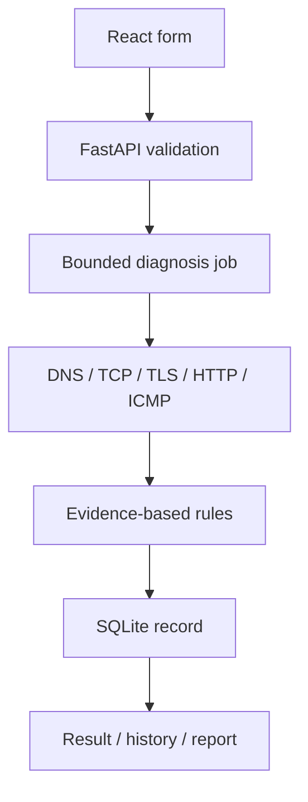

# NetCase architecture and acceptance

## Scope and flow

A single explicit target per diagnosis. The local React UI sends validated JSON to FastAPI on loopback; a bounded async job executes selected probes, generates deterministic conclusions, persists one SQLite record, and returns its ID. The UI polls progress and displays summary, metrics and raw evidence. No arbitrary shell input, bulk targets, cloud account, telemetry, or LLM dependency.

## Modules and data

| Area | Responsibility |
| --- | --- |
| `core/targets.py`, `models/schemas.py` | URL/host/port/timeouts and shape validation; reject credentials |
| `diagnostics/` | platform DNS discovery, direct DNS packets, socket/TLS/HTTP probes, bounded OS commands, orchestration |
| `analyzers/rules.py` | deterministic Chinese explanations with observed evidence, confidence category, next steps |
| `storage/database.py` | SQLite records and user preferences, favorites, drafts |
| `reports/export.py` | redact and render shareable reports |
| `frontend/src/pages/` | dashboard, new diagnosis, result, history, comparison, settings |

`DiagnosisRecord` has ID, timezone-aware UTC timestamp, normalized target, mode, overall status, elapsed time, module results, conclusions, rule version, environment, note, context and provenance (`runtime` or `imported`). `ModuleResult` has status, elapsed time, error type, human summary and bounded evidence. Historical differences are observations only; network label, resolver, address families, port, selected modules and time are compared separately.

## API (same-origin, local only)

| Method/path | Purpose |
| --- | --- |
| `GET /api/health`, `/api/dashboard` | status, real history statistics |
| `POST /api/diagnoses`, `GET /api/diagnoses/{id}` | start and poll up to two bounded concurrent jobs |
| `GET /api/records`, `GET/PATCH/DELETE /api/records/{id}`, `DELETE /api/records` | history, notes and deletion |
| `GET /api/records/compare?left=&right=` | two-record evidence comparison |
| `GET /api/records/{id}/report?format=json|markdown|html` | redacted export |
| `GET /api/records/export`, `POST /api/records/import` | redacted bulk export and explicitly imported JSON |
| `GET/PUT /api/settings` | saved preferences |
| `POST/DELETE /api/favorites`, `POST/DELETE /api/drafts` | saved targets and drafts |

Mutation requests require `X-NetCase-Client: dashboard`, Origin must be local on supported ports, Host must be loopback, and CORS is not enabled. This is browser isolation, not authentication against local processes. See `SECURITY.md`.

## Phase acceptance

- **Phase 0**: modules, data flow, API and risk decisions are documented here.
- **Phase 1 MVP**: `example.com` Quick Check returns real DNS/TCP/TLS evidence and a Chinese explanation; invalid input and timeout are handled. Backend tests, TypeScript build and front tests pass in the current Linux workspace. Windows real probe acceptance is outstanding.
- **Phase 2 workspace**: HTTP, Ping, traceroute, SQLite history, comparison, reports and settings are implemented. Platform-specific command output and DNS server discovery require real machine verification.
- **Phase 3 release**: documentation and CI exist; real screenshots, cross-platform manual acceptance, dependency license audit and owner license sign-off remain before a GitHub v0.1.0 tag.

## Tradeoffs and risks

The default system DNS is discovered from OS configuration; a tiny bounded DNS wire parser extracts A/AAAA/CNAME and RCODE with UDP/TCP fallback. It avoids another dependency but is less capable than a full resolver, and Windows/macOS DNS configurations may vary. TLS uses strict certificate validation. HTTP uses a header-only HTTP/1.1 socket to pin each hop to a validated address, preventing a second DNS resolution from silently changing to a private address; this excludes HTTP/2 and content checks. DNS, TCP and TLS timings come from independent probes, not an invented decomposition of an HTTP request. ICMP tools vary by OS, permissions, locale and environment. SQLite is local and synchronous for short queries; this is intended for small personal histories, not a monitoring server. Active jobs exist in process memory and do not survive restarts.

## Learning path and small exercises

1. Change one rule in `analyzers/rules.py` to explain `HTTP_429`; add a mock test that checks its evidence and next step.
2. Extend `diagnostics/dns.py` with one more RCODE test using a local fake response packet; keep timeout and size limits.
3. Add a history filter for one existing module status and verify both empty and populated states.
